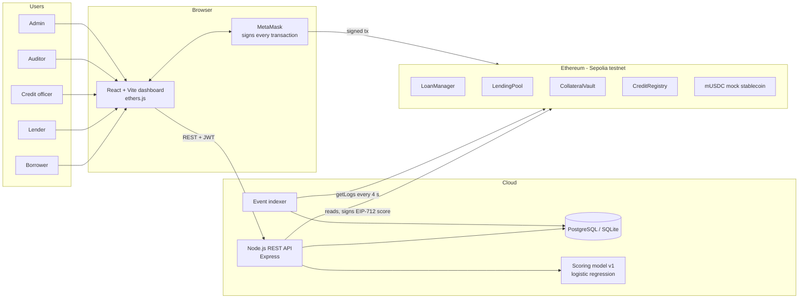
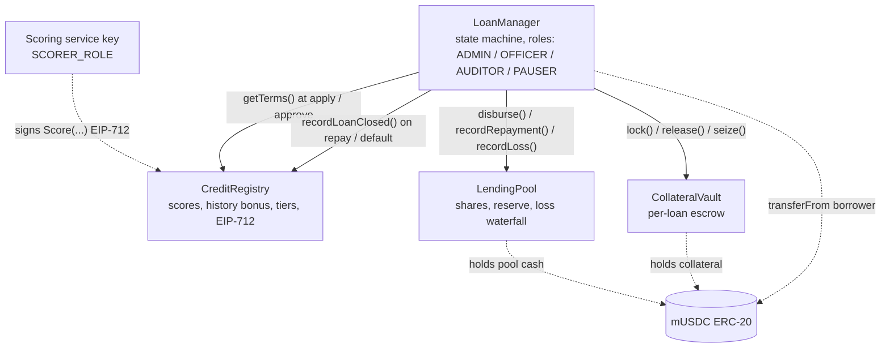
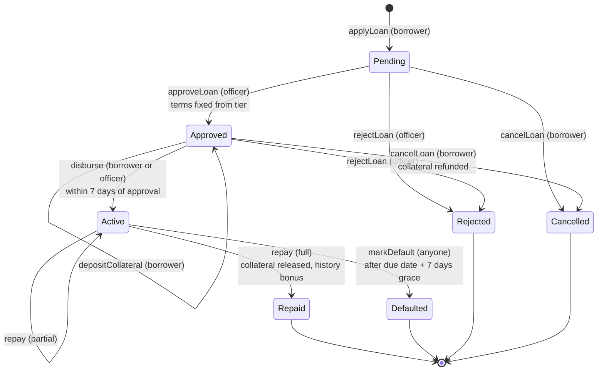
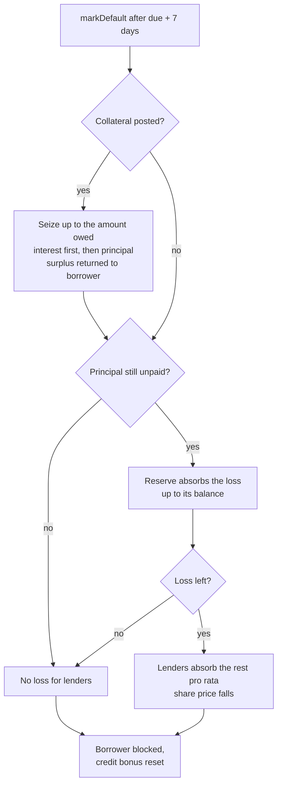
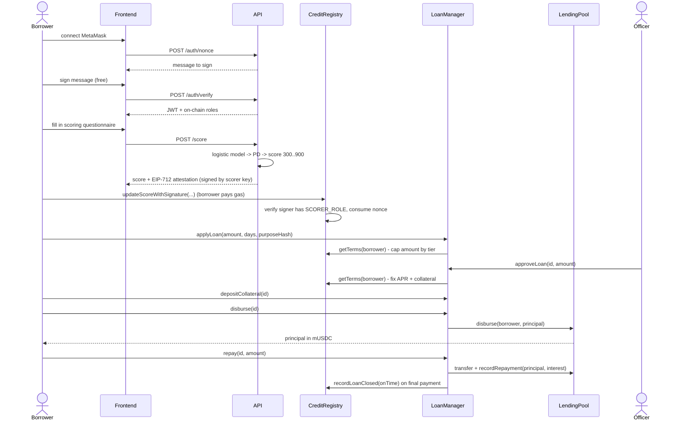
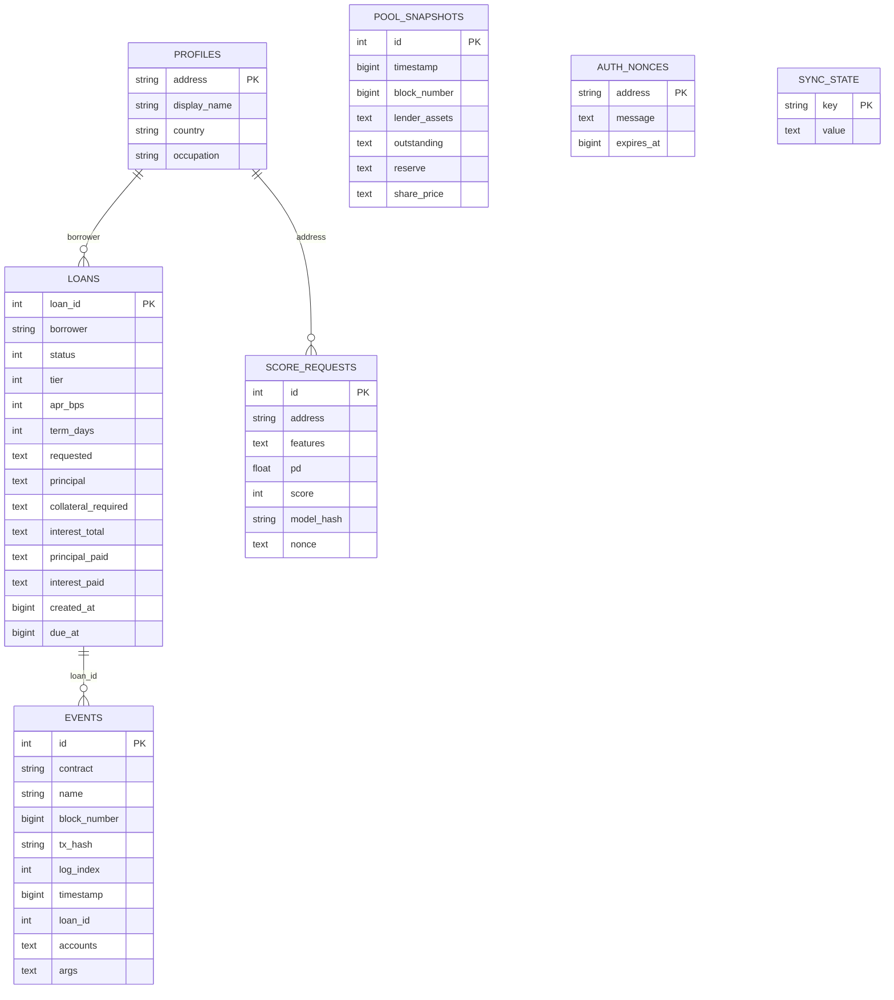
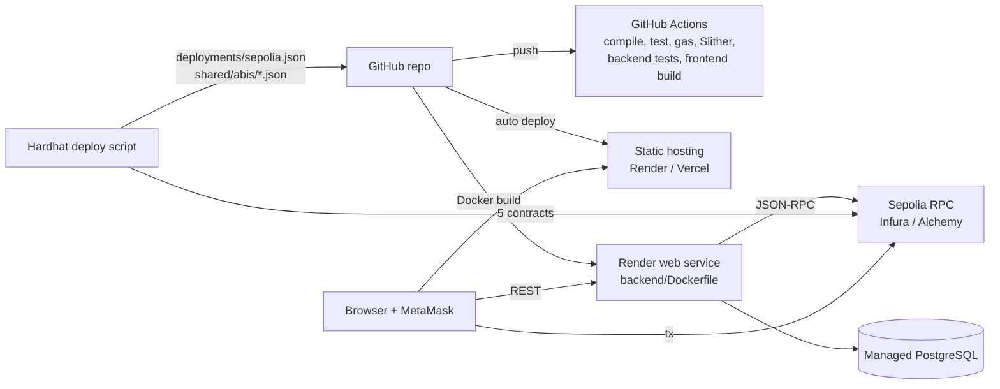

# MicroLend - System Architecture

Diagrams are written in [Mermaid](https://mermaid.js.org/) (GitHub renders them natively). To put them in the report or slides, paste the code into <https://mermaid.live> and export PNG/SVG.

## 1. System context and components

Design rules:

* **Money and permissions live on-chain.** The API never holds user funds and cannot move them. Its only on-chain power is signing credit-score attestations with a key that holds `SCORER_ROLE`; that key can be revoked by the admin.
* **The database is a read model.** Everything in the `events` and `loans` tables is rebuilt from the blockchain by the indexer. Only off-chain things (profile, score requests, sign-in nonces) are authoritative in the DB.
* **Roles come from the chain.** Admin, officer and auditor are read from `LoanManager.hasRole()` at login and re-checked every 30 s, so revoking a role takes effect quickly even for a valid token.

## 2. Smart-contract interaction

`LoanManager` is the **only** contract with `LOAN_MANAGER_ROLE` on the other three. Lenders talk to `LendingPool` directly (`deposit`, `withdraw`); everybody else goes through `LoanManager`.

## 3. Loan state machine

## 4. Default handling - the loss waterfall

## 5. Sequence: score, borrow, repay

## 6. Data model (off-chain read model)

Token amounts are stored as decimal strings (6-decimals integers) because they can exceed JavaScript's safe integer range.

## 7. Roles and permissions

| Capability | Borrower | Lender | Officer | Auditor | Admin |
|---|:-:|:-:|:-:|:-:|:-:|
| View public pool statistics, model card | ✔ | ✔ | ✔ | ✔ | ✔ |
| Request a credit score, apply, deposit collateral, repay | ✔ | | | | |
| Deposit / withdraw liquidity | | ✔ | | | |
| Approve / reject applications | | | ✔ | | |
| View all loans and the review queue | | | ✔ | ✔ | ✔ |
| Full event log, CSV export, audit summary | | | | ✔ | ✔ |
| Attach on-chain audit notes | | | | ✔ | |
| Pause, grant roles, fund reserve, tune tiers, block borrowers | | | | | ✔ |
| Declare a default after the grace period | anyone | anyone | anyone | anyone | anyone |

Borrower and lender are **not** on-chain roles: any connected wallet can act as either. Staff roles (`OFFICER_ROLE`, `AUDITOR_ROLE`, admin) are OpenZeppelin `AccessControl` roles on `LoanManager`. An officer cannot approve their own application.

## 8. Blockchain transaction types (≥ 10 required)

| # | Transaction | Contract | Sender |
|---|---|---|---|
| 1 | `deposit(amount)` | LendingPool | lender |
| 2 | `withdraw(shares)` | LendingPool | lender |
| 3 | `applyLoan(amount, termDays, purposeHash)` | LoanManager | borrower |
| 4 | `approveLoan(loanId, amount)` | LoanManager | officer |
| 5 | `rejectLoan(loanId, reasonHash)` | LoanManager | officer |
| 6 | `cancelLoan(loanId)` | LoanManager | borrower |
| 7 | `depositCollateral(loanId)` | LoanManager → CollateralVault | borrower |
| 8 | `disburse(loanId)` | LoanManager → LendingPool | borrower / officer |
| 9 | `repay(loanId, amount)` | LoanManager → LendingPool | borrower |
| 10 | `markDefault(loanId)` | LoanManager → Vault, Pool, Registry | anyone |
| 11 | `updateScoreWithSignature(...)` | CreditRegistry | borrower (relays scorer signature) |
| 12 | `updateScore(...)` | CreditRegistry | scorer |
| 13 | `addAuditNote(loanId, noteHash)` | LoanManager | auditor |
| 14 | `fundReserve(amount)` | LendingPool | admin |
| 15 | `grantRole / revokeRole` | any | admin |
| 16 | `pause / unpause` | LoanManager, LendingPool | pauser |
| 17 | `setBlocked`, `setTier` | CreditRegistry | admin |
| 18 | `setReserveBps`, `setMaxUtilizationBps` | LendingPool | admin |
| 19 | `faucet()`, `approve()` | MockStablecoin (test token) | any |

## 9. Deployment architecture

The API serves the contract ABIs (`GET /api/abis`) and addresses (`GET /api/config`) from the committed deployment files, so redeploying contracts never requires rebuilding the frontend.
